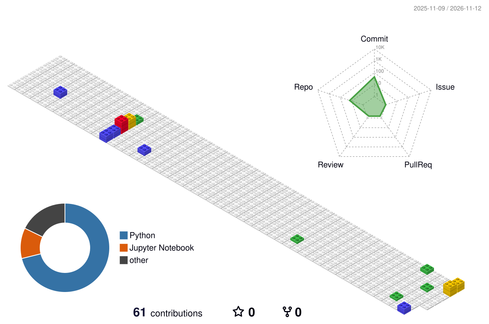

<h1 align="center">
  
</h1>

**Computer Vision · Anomaly Detection · On-device AI**를 다루는 AI 엔지니어입니다. 
비지도 이상탐지, 실시간 영상 복원, 블랙박스 영상 분석 같은 비전 문제를 주로 풀고 있고, 
최근에는 GPU 모델을 NPU로 옮기며 INT8 양자화로 엣지에서도 빠르게 돌리는 작업을 하고 있습니다.

적은 자원으로 높은 품질을 — 세밀한 단위로 쪼개 차이를 찾는 것을 좋아합니다. 🔍✨

## 🔎 You can find me on :

## 🥇 Primary technology stack

    

---

## 🚀 Featured Projects

| 프로젝트 | 내용 | 핵심 기술 |
|---|---|---|
| [**반도체 소자 이상탐지**](https://github.com/meister1378/Semiconductor-Unsupervised-Anomaly-Detection) | 결함 샘플이 거의 없는 공정에서 비지도 학습으로 이상 소자 탐지 | PatchCore, Isolation Forest |
| [**실시간 열화상 복원 (UPFN)**](https://github.com/meister1378/UPFN) | 노이즈·모션 블러·조도 열화를 단일 추론으로 복원 + 렌즈 왜곡 보정 | Restormer, FiLM Prompt Conditioning |
| [**블랙박스 영상 사고 분석**](https://github.com/meister1378/Car-Accident-Detection) | 재촬영 탐지 → 충돌·회피 분석 → 조향·가감속 탐지 3단계 파이프라인 | MViT, ConvNeXt, V-JEPA2 |
| [**이미지·영상 딥페이크 탐지**](https://github.com/meister1378/Hecto_DeepFake_Detection) | 이미지와 영상에 남은 생성·조작 흔적 탐지 | Computer Vision |
| [**OCR 모델 세대 교체**](https://github.com/meister1378/kocr-project) | 3단계 인식 파이프라인을 LoRA 파인튜닝 VL 모델 하나로 교체 | VL Model, LoRA |
| [**Ontology Graph RAG**](https://github.com/meister1378/ontology-graph-RAG) | 지식 그래프 기반 RAG 모델 | Knowledge Graph, RAG |
| [**Face Pseudonymization**](https://github.com/meister1378/Face-Pseudonymization) | 얼굴 가명처리 | MediaPipe, dlib |

그 외 실무 프로젝트

 

| 기간 | 프로젝트 | 내용 |
|---|---|---|
| 2026.08 | GPU → NPU 이식 + INT8 양자화 | 독립 코어 워커 풀 재설계로 9.2 → 23.0 fps, 지연 81.4ms → 31.4ms |
| 2025.08 – 2025.12 | 수질 이상탐지 파이프라인 | 결측치 보간 → T-GAT/D-GAT 이상 탐지 → LLM 자동 보고서 |
| 2025.02 – 2025.05 | DPO 기반 LLM 강화학습 | Gemma2로 선호 데이터 자동 생성, FSDP 학습, vLLM 서빙 |
| 2024.09 – 2024.10 | 혈동태 ROI 추출 | 2단계 YOLOv9 앙상블 + OpenCV 후처리 |

## 🏆 Awards — DACON

| 순위 | 대회 | 규모 |
|:---:|---|---|
| **2등** | 서울시 평균 기온 예측 AI 해커톤 | 624팀 · 상위 0.3% |
| **3등** | 반도체 소자 이상 탐지 AI 경진대회 | 383팀 · 상위 0.7% |
| **4등** | SW중심대학 공동 AI 경진대회 (예선) | 192팀 · 상위 2% |
| **4등** | 코드 유사성 판단 시즌2 AI 경진대회 | 133팀 · 상위 3% |
| 7등 | 2024 생명연구자원 AI활용 경진대회 | 940팀 · 상위 0.7% |
| 8등 | 선물 배송 경로 최적화 경진대회 | 241팀 · 상위 3% |
| 30등 | 대구 교통사고 피해 예측 AI 경진대회 | 942팀 · 상위 3% |
| 14등 | 블랙박스 영상 기반 지능형 고의사고 분석 모델 AI 경진대회 | 319팀 · 상위 4% |
| 22등 | HAI! Hecto AI Challenge (2025 하반기) — 채용 인재풀 등록 | 458팀 · 상위 4.8% |
| 41등 | 제3회 국민대학교 AI빅데이터 분석 경진대회 | 961팀 · 상위 5% |

전체 참가 이력 더보기

 

| 순위 | 대회 | 규모 |
|:---:|---|---|
| 114등 | 제주 특산물 가격 예측 AI 경진대회 | 1,093팀 · 상위 10% |
| 40등 | HD현대 AI Challenge | 330팀 · 상위 12% |
| 29등 | SW중심대학 공동 AI 경진대회 (본선) | 77팀 · 상위 37% |
| 57등 | 뉴스 기사 레이블 복구 해커톤 | 129팀 · 상위 44% |

